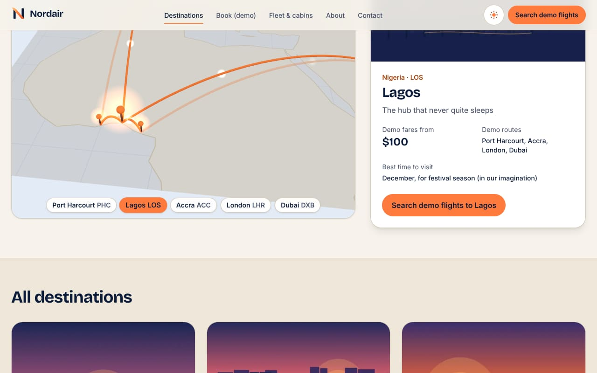
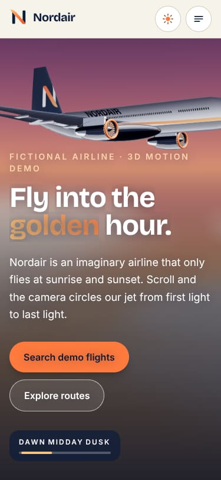

# Nordair — a fictional airline motion demo

> **Nordair is not a real airline.** This is a front-end portfolio demo. Flights, fares, aircraft and
> people are invented. There are no real bookings, no payments and no personal data is collected or
> sent anywhere. The name, "N" wing-mark, colours and copy are original and not affiliated with any
> real company.

A motion-heavy marketing site and demo booking flow built to show front-end animation craft:
a scroll-choreographed 3D hero (a fictional jet built entirely in code), a 3D cabin cutaway and 3D
route view, scroll-scrubbed timelines, self-drawing SVG routes, layout transitions and an animated
seat map — all with static poster fallbacks for `prefers-reduced-motion`, Save-Data, weak devices
and no-WebGL, full keyboard support and WCAG 2.2 AA checks in CI.

| Dawn (3D)                                       | Midday (3D)                                         | Dusk (3D)                                       |
| ----------------------------------------------- | --------------------------------------------------- | ----------------------------------------------- |
|  |  |  |

| 3D route view                                          | 3D hero on a phone                                       |
| ------------------------------------------------------ | -------------------------------------------------------- |
|  |  |

| Route map (dark)                                                  | Cabin sequence (dark)                                    | Demo results                                         |
| ----------------------------------------------------------------- | -------------------------------------------------------- | ---------------------------------------------------- |
|  |  |  |

| Seat map (375px)                                              | Mobile menu                                                  | Reduced motion (375px)                                                              |
| ------------------------------------------------------------- | ------------------------------------------------------------ | ----------------------------------------------------------------------------------- |
|  |  |  |

## What's inside

- **Home** — a CSS-only page-load intro (logo + progress bar, once per session); a 3D hero where
  the camera circles the fictional **Kestrel 500** jet as you scroll while the light shifts
  dawn → midday → dusk (nav lights and cabin windows glow at dusk); story beats as real HTML; a
  headline word-by-word reveal; scroll-pinned horizontal panels; count-up stats.
- **Destinations** — an SVG route map (stylised, hand-simplified coastlines) where flight paths
  between Port Harcourt, Lagos, Accra, London and Dubai draw themselves; an opt-in **3D view**
  (tilted map, arcing flight paths, pins) that shares state with the city buttons; hover, tap or tab
  to a city to open an animated destination card; a static list of every destination below.
- **Book (demo)** — Zod + React Hook Form search with inline errors, a fake "search", results with
  sortable layout animations, an animated seat map with roving-tabindex arrow-key navigation, and a
  boarding-pass style summary. Clearly marked "demo, no real booking".
- **Fleet & cabins** — a pinned scroll sequence where a **3D cabin cutaway** rebuilds itself from
  Economy (3-3) to Comfort+ (2-3-2) to Nord Suite (1-2-1), with instanced seats rippling down the
  aisle and mood lighting per cabin; the SVG version is the fallback.
- **About**, **Contact** (validates, then clears; nothing is sent), a full-screen animated mobile
  menu, an animated 404, light/dark themes with a circular view-transition reveal.
- **SEO** — per-page metadata and canonical URLs, generated Open Graph image, `sitemap.xml`,
  `robots.txt` and an SVG icon.

## Stack

Next.js 16 (App Router, Cache Components, all routes statically prerendered) · TypeScript ·
Tailwind CSS 4 · Motion (`motion/react`) · GSAP + ScrollTrigger · three.js + React Three Fiber +
drei (lazy-loaded) · Zod + React Hook Form · Vitest · Playwright + axe-core · Lighthouse.

## Getting started

```bash
npm install
npm run dev            # http://localhost:3000

npm run lint           # ESLint (next/core-web-vitals + TypeScript)
npm run format:check   # Prettier (+ Tailwind class sorting)
npm run typecheck      # next typegen && tsc --noEmit
npm test               # Vitest unit tests (search, pricing, seats)
npm run build
npm run test:e2e       # Playwright + axe-core (starts `next start` on :3300)

# Lighthouse (median of 3 runs, mobile + desktop) against a running production server:
npm run start -- -p 3200 &
BASE_URL=http://localhost:3200 npm run lighthouse   # set CHROME_PATH if needed
```

`npm run generate:art` regenerates the destination illustrations.
`BASE_URL=http://localhost:3200 npm run render:posters` re-renders the hero posters from the 3D scene.
`npm run bundle:report` prints initial and lazy (3D) JS sizes from the last build.
`BASE_URL=http://localhost:3200 node scripts/screenshots.mjs` regenerates the screenshots above
from a running server.

## How it was built

**Content as data.** Every user-facing string lives in [`src/content/site.ts`](src/content/site.ts)
and destination data in [`src/content/airports.ts`](src/content/airports.ts). Components only render
it.

**Three animation tools, each with one job.**

- **CSS** for anything that must never wait for JavaScript: the page-load intro, the headline reveal,
  route drawing and decorative loops. The intro is decided by a tiny inline `<head>` script (which
  also applies the saved theme before first paint, as recommended in the bundled Next.js
  "preventing flash before hydration" guide).
- **GSAP ScrollTrigger** for scroll-scrubbed timelines (hero flight, pinned panels, cabin
  sequence). GSAP is dynamically imported by a small `useGsap` hook, so it stays out of the initial
  bundle, and every timeline runs inside `gsap.matchMedia("(prefers-reduced-motion: no-preference)")`
  so it is fully reverted for reduced motion. Pinning uses CSS `position: sticky` rather than GSAP
  pin-spacers, so layout is decided by CSS before any script runs — no layout shift.
- **Motion** for UI state: menu, cards, step transitions, sort re-ordering, seat selection,
  segmented controls. It is loaded through `LazyMotion` with async features and wrapped in
  `MotionConfig reducedMotion="user"`; components that animate non-transform properties (clip-path,
  slides) also branch on `useReducedMotion()`.

**Reduced motion is a layout, not just "no animation".** A Tailwind custom variant,
`motion-ok:`, maps to `@media (scripting: enabled) and (prefers-reduced-motion: no-preference)`.
Tall scroll-scrubbed sections, sticky pinning and "hidden until revealed" states only exist inside
that variant, so reduced-motion and no-JS visitors get a normal, static page: the plane waits
mid-sky, every route is already drawn and the cabins become a list. All content is real text in the
DOM; animation only changes how it arrives.

**3D, only where it helps.** [`Stage3D`](src/components/three/Stage3D.tsx) always renders a static
poster first (the hero posters are rendered from the real scene by
[`scripts/render-posters.mjs`](scripts/render-posters.mjs)). A pure, unit-tested decision table in
[`capability.ts`](src/lib/three/capability.ts) then decides whether the scene may load:

| Visitor                                                                                         | What happens                                                 |
| ----------------------------------------------------------------------------------------------- | ------------------------------------------------------------ |
| Reduced motion, Save-Data, 2G, no WebGL, ≤ 2 GB RAM / ≤ 2 cores, software-rendered GPU, `?3d=0` | Poster only; three.js is never downloaded                    |
| Small screens and touch devices                                                                 | Poster, then 3D on the first scroll/tap/key press            |
| Capable desktops                                                                                | Poster, then 3D after first paint once the browser is idle   |
| `?3d=1` (testing/audits)                                                                        | Forces 3D, except for reduced motion, Save-Data and no WebGL |

At runtime a frame-time guard drops the pixel ratio, then restores the poster if the frame rate
stays below ~24 fps; a lost WebGL context also restores the poster; rendering pauses when the scene
is off-screen or the tab is hidden. Canvases are `aria-hidden` — every word stays in normal HTML.

**The Kestrel 500 is built in code** ([`src/components/three/aircraft`](src/components/three/aircraft)):
NACA 4-digit airfoil sections lofted into tapered, swept wings with dihedral and washout, canted
winglets, airfoil tail surfaces, a lathed fuselage with an upswept tail, nacelles with spinning fan
faces, flap-track fairings and nav lights. The livery (navy belly, sunrise cheatline, wing-mark on the
fin, NORDAIR wordmark), panel-line bump maps and dusk window glow are painted on canvases at runtime,
so there are **no model or texture downloads** and nothing copied from a real airline. Materials are
physically based (clear-coat paint, brushed metal) lit by drei `Lightformer` panels instead of an
HDRI, with a shader sky, a cloud sea and city lights.

**Deterministic fake data.** [`src/lib/search.ts`](src/lib/search.ts) validates searches (Zod) and
generates flights with a seeded PRNG, real great-circle distances and fixed UTC offsets for local
arrival times; connections route through the Lagos hub.
[`src/lib/pricing.ts`](src/lib/pricing.ts) is a transparent fare formula (distance × cabin ×
advance purchase × weekday × time-of-day ± 5%). Both are unit-tested, as is the seat-map generator.

**Original artwork.** The logo, plane, cabins, map and destination illustrations are hand-written
SVG; the destination "postcards" are rendered to small WebP files by
[`scripts/generate-art.mjs`](scripts/generate-art.mjs) and served through `next/image`. Fonts
(Bricolage Grotesque + Inter) are self-hosted via `next/font`.

## Quality checks

The Playwright suite runs every page and the key flows at **375, 768 and 1280px in light and dark**,
plus **reduced-motion** projects at 375 and 1280px (light and dark). Each page test scrolls the
whole page, then asserts: no horizontal overflow, no console errors, and zero axe-core violations
for `wcag2a`, `wcag2aa`, `wcag21a`, `wcag21aa` and `wcag22aa`. Interaction tests cover the full booking
flow (validation, keyboard seat selection, no non-GET requests), the route map, the mobile menu
(focus and Escape), theme persistence, the contact form, the intro, reduced-motion layouts and SEO
files.

The 3D tests (`tests/e2e/three.spec.ts`) force the scenes on with `?3d=1` in software WebGL and
check the canvas is decorative and the text is intact, plus every fallback: no WebGL, Save-Data,
weak device, software GPU, `?3d=0`, reduced motion and a lost WebGL context — asserting the poster
stays and three.js is never downloaded.

Lighthouse results (median of 3 runs, local production build) are in the pull request description.

## Project structure

```
src/
  app/                 routes, metadata files (sitemap, robots, OG image, icon), globals.css
  components/          brand, layout (header, menu, theme), home, destinations, book, fleet, contact, ui
  content/             site.ts (all copy), airports.ts (destination data)
  components/three/    Stage3D loader, SceneCanvas, hero / cabin / route scenes, aircraft builder
  lib/                 search, pricing, seats, geo, map geometry, metadata, useGsap, three/capability
tests/unit/            Vitest
tests/e2e/             Playwright + axe-core
scripts/               art generation, poster rendering, screenshots, bundle report, Lighthouse
```
